# PixelMug Glucose Face 🤪🩸

Turns a PixelMug into an ambient blood-glucose display. It reads [Dexcom Share](https://www.dexcom.com/)
in real time and shows your glucose on the mug's 32×16 LED: as an animated face or scene that
changes with your level, as scrolling warnings, or as a 6-hour graph. It runs as an Android app on
your phone and talks to the mug through a [Bubble](https://github.com/bubble-im) bot.

> [!WARNING]
> **Not a medical device.** The mug is something to glance at, nothing more. It can be late, wrong
> or silent. Never rely on it instead of your CGM's own alarms, and don't base treatment decisions
> on it. It uses Dexcom Share, an unofficial API that Dexcom can change or close at any time.

**Works in mmol/L and mg/dL**, with your own limits, Dexcom servers in the US, Japan and the rest
of the world, and an app in English and Swedish. See [Units, limits and languages](#units-limits-and-languages).

<p align="center">
  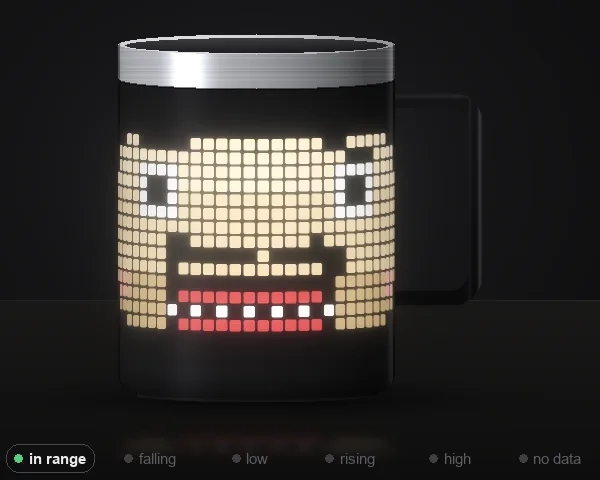<br>
  <em>The built-in face on the black PixelMug S1 Pro, cycling through the six glucose states.
  Mockup rendered from the real 32×16 GIFs with <code>scripts/mug_s1.py</code>.</em>
</p>

## What the face means

| | Face | Shown when | Animation |
|---|---|---|---|
| 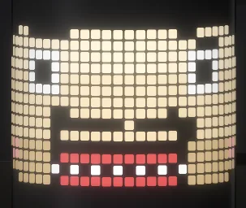 | **happy** | glucose **between the urgent limits** and no warning | talks (grin opens/closes), blinks, pink cheeks |
| 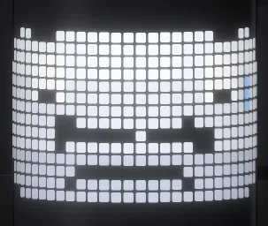 | **worried** | **falling** — 20-min projection **≤ 3** | pale, brows up, frown quivers, sweat drips down |
| 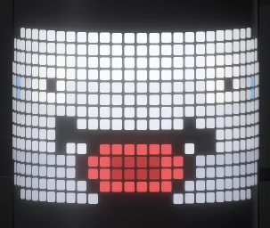 | **panic** | **low, ≤ 3.0** | pale, wide eyes, red mouth screams (pulses), sweats & shakes |
| 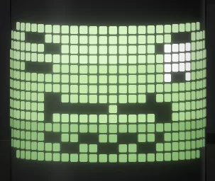 | **queasy** | **rising** — 20-min projection **≥ 14** | green, woozy eyes, wavy mouth ripples |
| 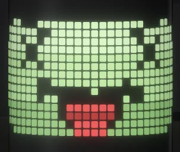 | **sick** | **high, ≥ 14.0** | green, X eyes, tongue lolls in and out |
| 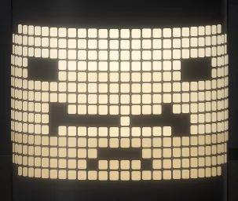 | **sleep** | reading **stale (> 16 min)** or no data | eyes closed, breathing, a snore bubble — never a "healthy" face on data it can't trust |

Skin colour is itself a signal: **tan = fine, pale = low, green = high**. The numbers above are
the defaults in mmol/L (54 and 252 mg/dL); the app lets you set your own urgent limits and
prediction window.

## How it works

```
Dexcom Share ──6h──▶ assess level ──▶ render face (32×16 animated GIF) ──▶ publish ──▶ Bubble bot ──talPlayGif──▶ PixelMug P1
   every 5 min         alerts.ts            face.ts, ≤40 KB GIF89a          public URL           (runs on your box)
```

Each face is a small looping animation (talking mouth, blink, sweat drip, wobble, breathing)
built from a full-canvas rounded-rect head with a vertical skin gradient plus hand-drawn
eye/brow/moustache/mouth sprites. Every mug GIF is under ~1 KB — far below the 40 KB `talPlayGif` cap.

## Quick start

```bash
bun install          # deps (gifenc)
bun run setup        # fetch the third-party Bubble SDK into ./sdk (not committed)
bun run dryrun       # render every face to ./out (+ your live face if creds set) — NO mug/token needed
bun test             # 42 tests incl. face validity, level→expression, face-pack loading
```

`dryrun` uses synthetic data by default; drop real Dexcom creds into `.env` to see the face for
your live level.

### Hosting the GIF (so the mug can fetch it)

```bash
bun run serve                                   # serve ./out on :8787
cloudflared tunnel --url http://localhost:8787  # -> public URL for GIF_PUBLIC_BASE_URL
```

See [HOSTING.md](HOSTING.md) for tailscale-funnel and bucket options.

### Running against a real mug

```bash
cp .env.example .env # fill in BOT_TOKEN, Dexcom creds, GIF_PUBLIC_BASE_URL
bun run bot
```

Then open the bot's chat in the Bubble app, attach your PixelMug, and send `/start`.

## Making a face pack (swap the GIFs)

The faces are **swappable**. A *face pack* is just a folder with six GIFs — one per mood:

```
my-theme/
  happy.gif   worried.gif   panic.gif
  queasy.gif  sick.gif      sleep.gif
```

Each GIF must be **exactly 32×16, GIF87a/89a, ≤ 40 KB** (the mug's `talPlayGif` rules).
Animation is welcome — that's what the mug plays.

**1. Start from the built-in faces** (so you get correctly-sized files to edit):

```bash
bun run export-faces my-theme     # writes the 6 current faces into ./my-theme
```

**2. Edit or replace** each `my-theme/<mood>.gif` in any pixel / GIF editor — keep it 32×16.

**3. Use the pack** — point `FACE_PACK` at the folder (flag or in `.env`):

```bash
FACE_PACK=my-theme bun run dryrun   # validates every file, prints "pack" vs "built-in"
FACE_PACK=my-theme bun run bot      # run the mug with your pack
```

Good to know:
- **Any missing file falls back** to the built-in NOT-man face, so a partial pack is fine.
- `dryrun` checks each pack GIF and fails loudly if one breaks the 32×16 / ≤40 KB rules.
- Keep several folders (`zombie/`, `cat/`, `minimal/`, …) and switch by changing `FACE_PACK`.
- The pack only changes the **pictures**. Which mood maps to which glucose level lives in
  `expressionForLevel()` (`src/face.ts`) and the table above — that logic is unchanged.
- **Prefer to draw in code?** Edit the sprites in `src/face.ts` (head, eyes, brows, moustache,
  mouths) and re-run — no files needed.

### Included packs

Twelve ready-made packs ship in `packs/` — seven ambient scenes and five characters, each in a light
(P1) and a dark (S1 Pro) variant. All read the same six glucose states. Every preview below is the
dark variant on the black S1 Pro, cycling through the states in the label row:

<p align="center">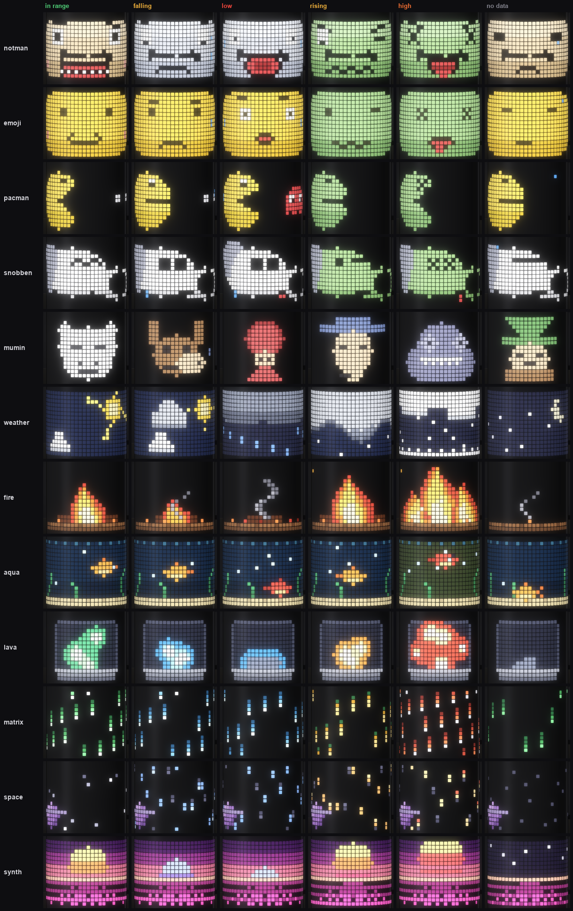</p>

Point `FACE_PACK` at one (flag or `.env`):

```bash
FACE_PACK=packs/weather bun run bot   # or fire, aqua, lava, matrix, space, synth, emoji, pacman, snobben, mumin
```

**Emoji** 🙂 — `packs/emoji` — the colour reinforces the level (yellow → green when high).

<p align="center">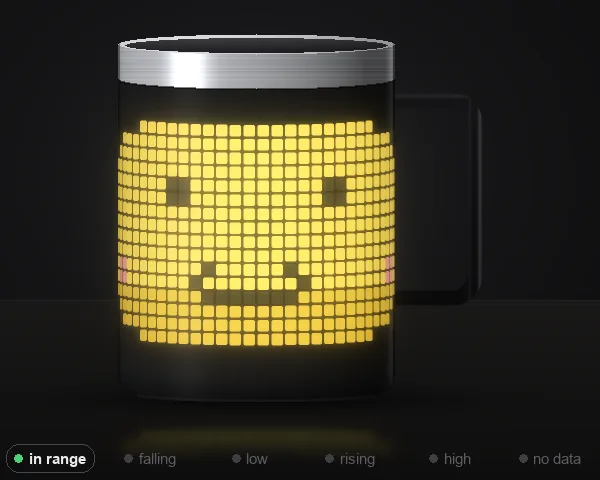</p>

**Pac-Man** 🟡 — `packs/pacman` — chomps pellets in range; a ghost closes in when you go low.

<p align="center">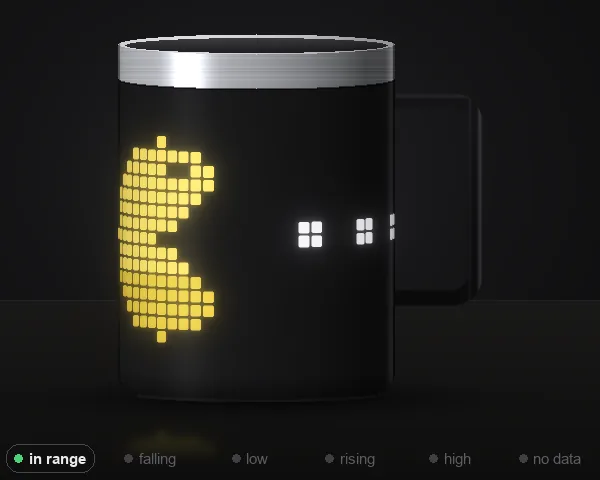</p>

**Snobben** 🐶 — `packs/snobben` — a Snoopy-style beagle with the floppy ear.

<p align="center">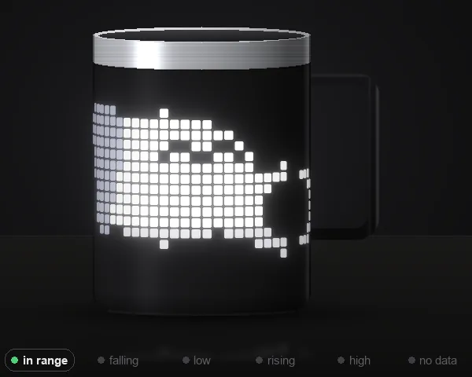</p>

**Mumin** — `packs/mumin` — a Moomin *variety* pack: a different character per mood
(Moomintroll / Sniff / Little My / Hemulen / the Groke / Snufkin).

<p align="center">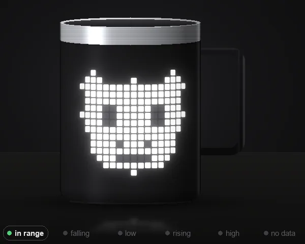</p>

**Väder — himmelen ÄR ditt glukos** 🌤️ — `packs/weather` — an ambient sky you can read across the
room, no numbers: ☀️ sun in range, 🌥️ clouds drift in as you fall, ⛈️ thunder + lightning when
you're low, ☁️ a churning grey lid as you climb, 🌨️ snowfall when you're high, 🌙 a calm night
when the reading is stale. Six frames each for smooth motion. Generate with `bun run gen-weather`
(and `THEME=dark bun run gen-weather` for the black S1 Pro).

<p align="center">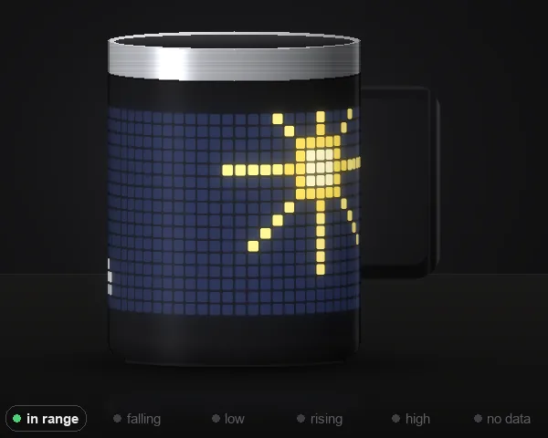</p>

**Lägereld — lågan ÄR ditt glukos** 🔥 — `packs/fire` — a campfire that breathes calmly in range,
🔥 grows and turns orange as you climb, 🔥🔥 roars into a spark-throwing blaze when you're high,
🔥 shrinks and dims as you fall, 🌡️ gutters down to glowing embers + rising smoke when you're low,
and 🪵 goes to a cold hearth with one last coal when the reading is stale. Real flicker, six frames.
Generate with `bun run gen-fire` (and `THEME=dark bun run gen-fire` for the black S1 Pro).

<p align="center">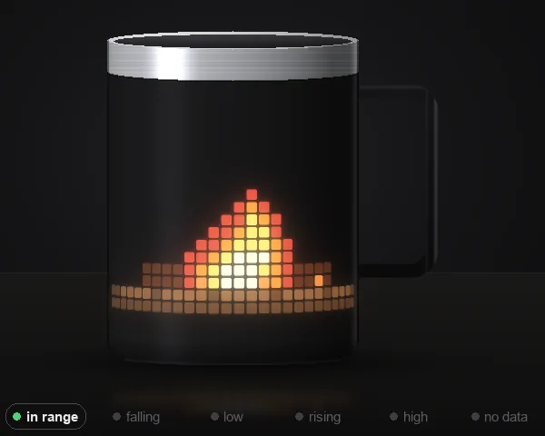</p>

**Akvarium — fisken ÄR ditt glukos** 🐟 — `packs/aqua` — a goldfish drifting calmly to and fro in
range, 🐟 sinking as you fall, 🐟 climbing toward the surface as you rise, 🐟 gasping in a murky warm
tank when you're high, darting a frantic red along the bottom when you're low, and 🌙 resting on the
sand when the reading is stale. Swaying weeds, rising bubbles, six frames each. Generate with
`bun run gen-aqua` (and `THEME=dark bun run gen-aqua` for the black S1 Pro).

<p align="center">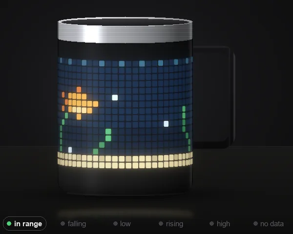</p>

**Lavalampa** 🌋 — `packs/lava` — molten metaball blobs: green bob in range, sink and cool to blue as
you fall/are low, boil red-hot up top when you're high. Colour + height + motion all track glucose.

<p align="center">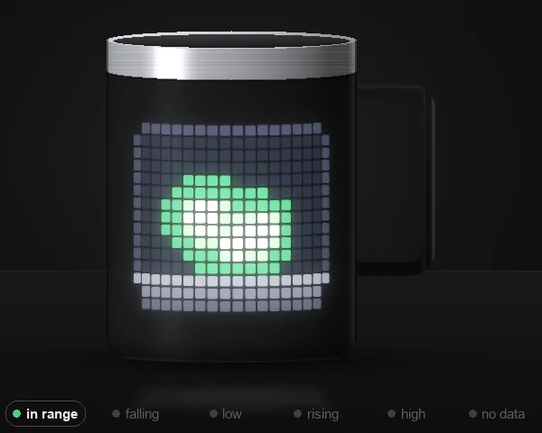</p>

**Matrix** 🟩 — `packs/matrix` — digital rain: green and steady in range, blue and glitchy when low,
amber climbing, red and racing when high, a dim idle drizzle when stale.

<p align="center">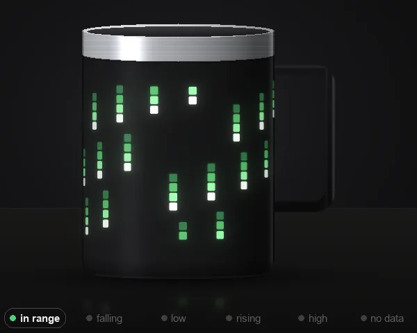</p>

**Rymd** 🌌 — `packs/space` — a starfield past a little ringed planet: stars drift up as you rise,
down as you fall, gently twinkle in range, blaze into a red warp when high / cold-blue warp when low.

<p align="center">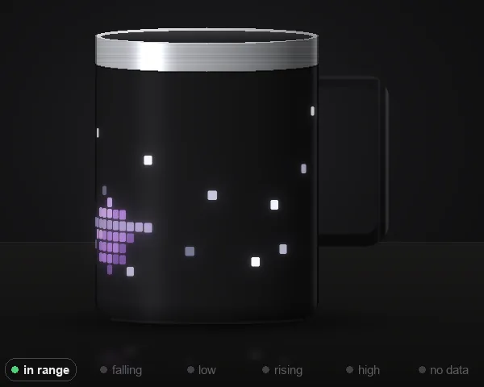</p>

**Synthwave** 🌇 — `packs/synth` — a retro sun over a neon perspective grid: it rides high and hot-red
when you're high, sits mid and warm in range, sinks and cools as you fall/are low, night when stale.

<p align="center">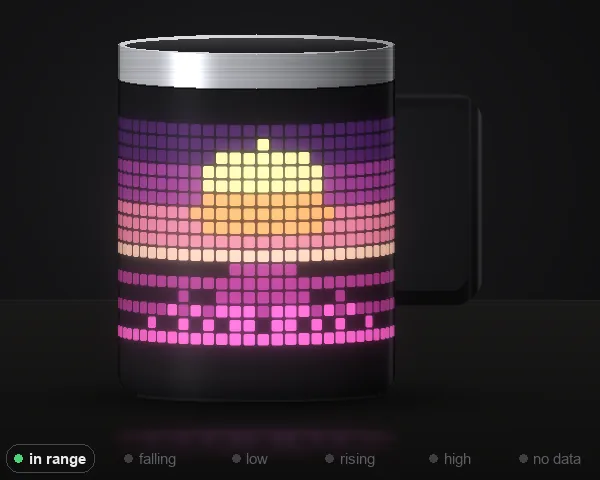</p>

Each is generated by its script (`bun run gen-emoji` / `gen-pacman` / `gen-snobben` / `gen-weather` / `gen-fire` / `gen-aqua` / `gen-lava` / `gen-matrix` / `gen-space` / `gen-synth`) — edit the
matching `src/gen-*.ts` to tweak. Original pixel art — playful homages, not the real characters;
for personal use on your own mug.

### Extras

Two showpiece GIFs that aren't tied to glucose. The app has a button for each, and they live in
`packs/extras/`:

<p align="center">
  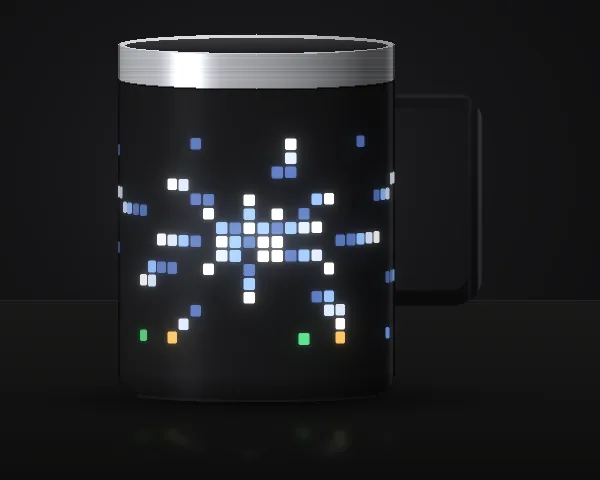
  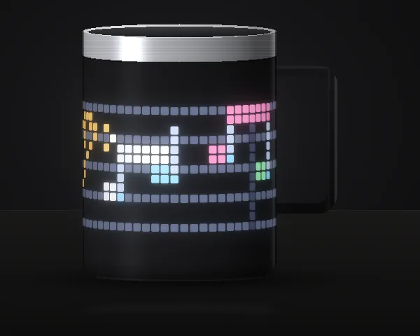
  <br><em><b>Hyperrymd</b>: the jump to lightspeed, seen from the cockpit (<code>src/gen-hyperspace.ts</code>) ·
  <b>Notes</b>: dancing on a scrolling staff with a cello (bass) clef (<code>src/gen-notes.ts</code>)</em>
</p>

### Designing for the LED — and previewing on the mug

The mug shows exactly the pixels you send. What reads well depends on the model:

- **Black S1 Pro**: the LEDs sit behind the black shell, so an unlit (near-black) pixel simply
  vanishes. Design on a **black background** and let the figures glow; outlines aren't needed. Every
  generator makes this variant with `THEME=dark` (`packs/<name>-dark/`). A light background lights
  up as one big glowing rectangle.
- **White P1**: the background is the light ceramic. Design on a **light background**, and give
  white or pale shapes a **dark outline** or they disappear (Snobben has a black outline, ear and nose).
  Bright saturated colours read well; pale ones wash out.

Preview any pack or GIF as it will look on the black S1 Pro. The mockup is drawn to scale, using
proportions measured from PixelMug's own S1 Pro photos and the spec (a 6.21″ display that wraps
slightly more than 180°). Each LED is about 5 % of the mug's diameter, so the outermost columns
turn edge-on around the sides. Unlit LEDs disappear into the black shell, and lit ones glow and
reflect on the table:

```bash
python3 scripts/mug_s1.py packs/weather-dark docs/mug/weather.webp        # a pack: cycles the six states
python3 scripts/mug_s1.py packs/extras/notes.gif docs/mug/notes.webp       # one GIF
python3 scripts/mug_s1.py packs/notman-dark/happy.gif face.webp --closeup  # just the display
bash scripts/render_previews.sh                                            # re-render every README preview
```

It needs Python 3 with Pillow and numpy. For the white P1 there is `scripts/mug_mockup.py`.

## Run on the phone (Android app)

`android/` is a native Kotlin app that runs the whole loop **on your phone** — no PC, no tunnel.
Every 5 min it fetches Dexcom, picks the expression, and pushes the matching pack GIF to the mug
via the Bubble bot API (a foreground service).

```bash
cd android
./gradlew :app:assembleDebug
adb install -r app/build/outputs/apk/debug/app-debug.apk
```

In the app: enter your **bot token** and **Dexcom** login, pick your **Dexcom Share server**,
**units** and **limits**, tap **Connect mug** (open the Bubble app and send `/start` so it can
capture the chat), then **Start**. **Test push** fires one update.

Three **modes**:
- **Face**: one of the packs (fetched from the GIF base URL). Pick with a live preview.
- **Text**: scrolling warnings via the mug's own font service (no hosting). The six warning texts
  are **editable** with `{v}` / `{arr}` / `{pred}` / `{min}` placeholders.
- **Graph**: the phone renders the 32×16 VU-meter GIF itself (`Gif.kt` + `GraphRender.kt`) and
  uploads each frame to litterbox for the mug to fetch. Warnings scroll over the graph.

> [!CAUTION]
> Graph mode uploads a picture of your glucose graph to a **public, anonymous** file host
> (litterbox.catbox.moe) every five minutes; each picture is kept for an hour. Face and Text modes
> don't upload any health data. Moving the rendering onto the mug itself will remove this.

> The mug fetches each face from a **public URL** (`GIF base URL` → `<base>/packs/<pack>/<expr>.gif`).
> The default is this repo through jsDelivr (`https://cdn.jsdelivr.net/gh/TommyEneroth/pixelmug-glucose-bot@main`);
> point it at your own fork or any static host to serve your own packs.

## Units, limits and languages

- **Units:** mmol/L or mg/dL. A new install picks the unit your country uses (mmol/L in the
  Nordics, UK, Ireland, the Netherlands, Canada, Australia and a few more; mg/dL elsewhere).
  Everything is computed in mg/dL, which is what Dexcom sends; mmol/L is only for display.
- **Limits:** urgent low, target range and urgent high, plus the prediction window (5–60 min).
  Defaults: 3.0 / 3.9–10.0 / 14.0 mmol/L (54 / 70–180 / 252 mg/dL). The graph colours and its
  shaded band follow your target range. The app won't save limits that are out of order.
- **Dexcom Share server:** outside the US (default), US, or Japan, which has its own server.
- **Languages:** the app is in English, with Swedish if the phone is set to Swedish. The default
  warning texts follow the phone's language too, and stay neutral: they state the value and trend,
  never what to do about it. Write your own if you want more.
- **On the mug:** the pixel font has A–Z, Å, Ä, Ö, digits and a few symbols. Other accented
  letters show as their base letter (Ü→U, É→E, Ñ→N, Æ→AE, Ø→O). Scripts like Japanese or Chinese
  can't fit in 32×16 pixels; use the Face mode packs, which have no text.

## Project layout

| File | Purpose |
|---|---|
| `src/face.ts` | the animated 32×16 built-in face — head, expression sprites, `renderFaceGif` |
| `src/facepack.ts` | picks the GIF per mood: a `FACE_PACK` folder if set, else built-in |
| `src/export-faces.ts` | `bun run export-faces <dir>` — dump the built-in faces as editable GIFs |
| `src/gen-*.ts` (emoji · pacman · snobben · mumin) | generators for the bundled packs |
| `packs/` | ready-made face packs: `emoji/`, `pacman/`, `snobben/`, `mumin/` — pick via `FACE_PACK` |
| `src/alerts.ts` | level + 20-min prediction (`assess`) that picks the expression |
| `src/dexcom.ts` | Dexcom Share client (EU/US), session cache, least-squares trend |
| `src/hosting.ts` | write GIF to `./out` and build the public URL the mug downloads |
| `src/glucoseBot.ts` | the Bubble bot: `/start`, refresh/temp/battery, 5-min push loop |
| `src/render.ts` | (from main) still provides `assertMugGif` — the GIF constraint validator |
| `src/dryrun.ts` | render & validate every face with no mug or token |
| `sdk/` | third-party Bubble SDK, fetched by `bun run setup` (gitignored) |

## Design notes
- The head fills the whole 32×16 (rounded-rect, no empty rows), so features get maximum room.
- Skin uses three shades (highlight / base / jaw-shadow) per tone for a bit of depth; the
  mouth has a dark-red interior; happy gets pink cheeks.
- Each mood has an **animated mouth** (talk / scream-pulse / quiver / ripple / tongue / breathe)
  plus expressive eyebrows and a crooked NOT-man moustache.
- Thresholds are configurable (in the app, or `LOW_URGENT`, `HIGH_URGENT`, `PRED_WINDOW_MIN` for
  the bot); the prediction is `current + least-squares slope × window`, not Dexcom's laggy arrow.
- **Stale > 16 min → asleep**, never a "healthy" face — an old value must not look reassuring.
- Skin colour is itself a signal: tan = fine, pale = low, green = high.

## Security
- No secrets in the repo: `.env` is gitignored; credentials come from env only.
- The third-party SDK is fetched at setup time, not redistributed here.
- The Android app keeps your Dexcom login and bot token in the app's private storage on the phone,
  not encrypted. Encrypting them is on the to-do list.

## License

The code is [MIT](LICENSE). The **Snobben**, **Mumin** and **Pac-Man** packs are fan homages to
characters owned by others (Peanuts, Moomin Characters, Bandai Namco). They're made for personal
use on your own mug and are not covered by the MIT license; don't redistribute or sell them.

---
Built for the PixelMug P1 and S1 Pro. A playful nod to the Anthrax "NOT-man", not affiliated with
Anthrax, PixelMug / jeejio, or Dexcom. Not a medical device.
